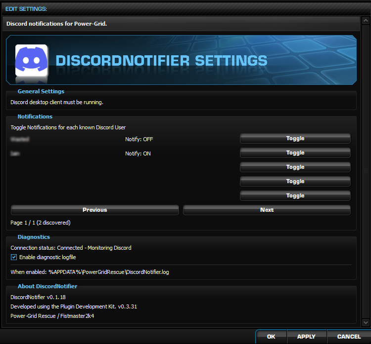
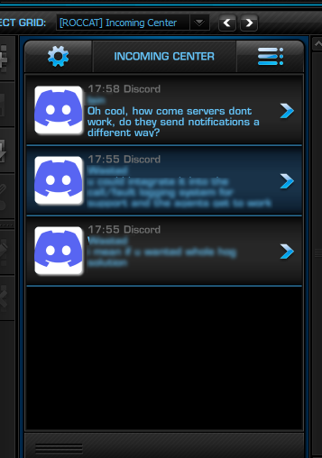
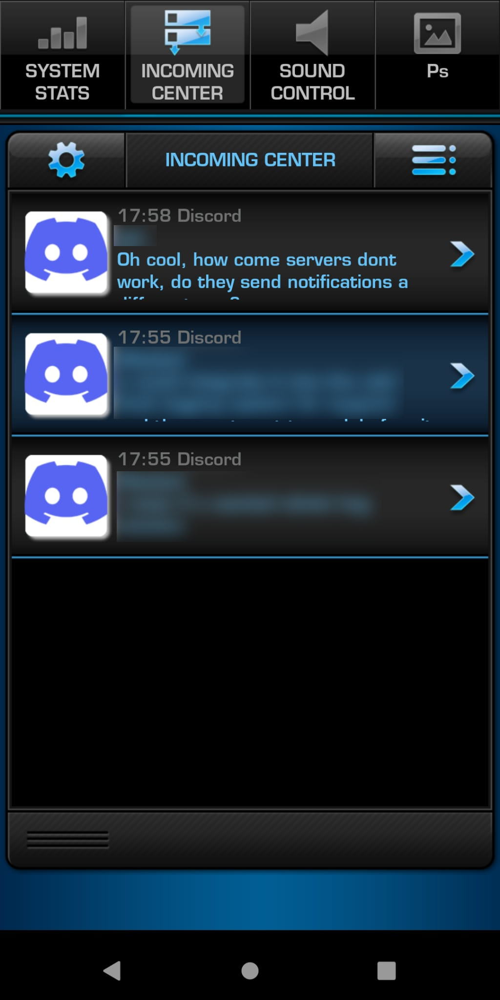
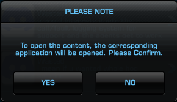
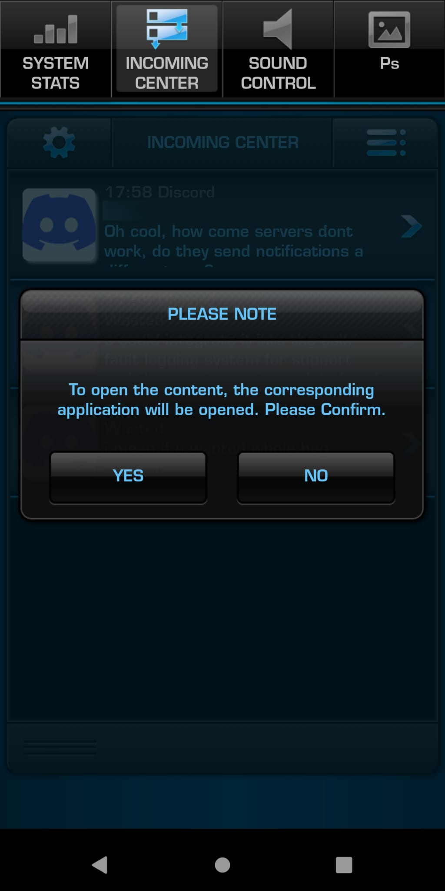

# DiscordNotifier for ROCCAT Power-Grid

**Discord direct-message notifications on your ROCCAT Power-Grid desktop and Android controller — with one-tap navigation to the exact message in Discord on your PC.**

DiscordNotifier is an unofficial plugin for [Power-Grid Rescue](https://github.com/fistmaster2k4/Power-Grid-Rescue). It connects to the **running Discord desktop application** through Discord's local RPC/IPC interface and places notifications in Power-Grid's original **Incoming Center**. It uses the existing Power-Grid interface; no changes to Incoming Center scripts are needed.

**Current documented release:** v0.1.18.

## What it looks like

### DiscordNotifier settings



### Incoming Center on Windows



### Incoming Center on Android



### Opening a message — confirmation on Windows



### Opening a message — confirmation on Android



## Features

- **Direct-message notifications:** Displays the sender/title, message preview, and arrival time in Incoming Center. Long previews wrap and may be clipped to fit the original fixed-size panel.
- **Open the exact Discord message:** Click or tap a notification, confirm Power-Grid's external-content prompt, and the **Discord desktop application on the PC** navigates to and highlights the originating message.
- **Android as a remote controller:** Notifications appear on the Power-Grid Android client. Tapping one opens the corresponding message **on the Windows PC**, not in Discord on the phone.
- **Useful while gaming:** In a tested dual-monitor setup, tapping a phone notification moved Discord to the exact message on one monitor without minimising the fullscreen game on the other. This is an observed result, not a guarantee for every game or fullscreen mode.
- **Passive sender discovery:** Automatically learns senders from notifications it receives. No server-member download, contact-list scan, username search, or separate Discord bot is needed.
- **Per-sender Notify toggle:** Each discovered sender defaults to **Notify: ON**. Switch to **OFF** to prevent *new* notifications from that sender appearing in Power-Grid, without muting or blocking them in Discord.
- **No notification backlog:** Turning a sender back ON does not import messages received while their Power-Grid notifications were disabled; only subsequent notification events appear.
- **Five senders per settings page**, with Previous/Next navigation. Empty slots are intentional and harmless.
- **Saved preferences:** Discovered senders and Notify choices survive Power-Grid restarts and plugin package updates (verified in testing).
- **Live connection status:** Diagnostics reports whether the plugin is connecting, connected and monitoring, or reconnecting. Connection status is not added as a message in Incoming Center.
- **Optional diagnostic log**, and automatic reconnection after Discord IPC disconnects.

## Requirements

- A working installation of **ROCCAT Power-Grid restored with [Power-Grid Rescue](https://github.com/fistmaster2k4/Power-Grid-Rescue)** on Windows.
- The **Discord desktop client**, installed and running **on the same Windows PC** as Power-Grid.
- The **DiscordNotifier RPGP plugin package** installed through the Power-Grid plugin workflow.
- One-time Discord authorisation of the plugin when first connecting. Later sessions can reuse securely stored credentials; reauthorisation may be necessary if credentials expire or are revoked.
- **Optional:** the compatible Power-Grid Android client connected to the Windows host, if you want phone/tablet notifications and remote message navigation.

**You do not need** a Discord server bot, permission to administer a server, Windows toast notifications, or Discord installed on the Android device for the PC-navigation feature.

## Install and connect

1. Install and run Power-Grid Rescue, including the Windows host and (optionally) its Android client.
2. Install the released **DiscordNotifier `.rpgp`** into Power-Grid using the available plugin installer/PDK workflow.
3. Ensure the **Discord desktop app** is running on the PC.
4. Start or restart the Power-Grid host so the plugin loads.
5. Follow the Discord authorisation prompt if this is your first connection. Authorise only if you trust the plugin.
6. Open **Power-Grid Launcher → Settings → DiscordNotifier Settings**.
7. Under **Diagnostics**, check for **`Connection status: Connected - Monitoring Discord`**.
8. Have somebody send you a **new DM** while that conversation is not being actively viewed. It should appear in **Incoming Center**.

Power-Grid displays its own confirmation before opening the message. Choose **YES** to navigate to the message in desktop Discord, or **NO** to stay where you are.

## Understanding the notification path

```text
Discord desktop client
    ↓ local Discord IPC / RPC notification event
DiscordNotifier.dll on Windows
    ↓ original Power-Grid incoming-source interface
Power-Grid Incoming Center on Windows / Android
    ↓ tap or click → Power-Grid's confirmation → YES
Windows desktop Discord opens the originating message
```

**Important:** Power-Grid's Android client is a remote interface for the PC. The **YES** button sends the action to the Windows host. It does **not** launch the mobile Discord app. On the PC, DiscordNotifier uses Discord's `discord://` deep-link protocol so Windows can hand navigation to the native desktop app, including the originating message ID when provided.

In testing, choosing YES opened the correct DM **and highlighted the individual message**. It did so from both the desktop Incoming Center and the Android controller.

## Settings reference

| Section | Setting | What it does |
| --- | --- | --- |
| General Settings | Discord desktop requirement | Reminds you that Discord must be running locally on the Windows PC. |
| Notifications | Discovered users | Lists senders learned from notifications received by this plugin. |
| Notifications | **Notify: ON / OFF** + **Toggle** | Enable or suppress *future Power-Grid alerts* from an individual sender. This does not alter Discord's own notification or mute settings. |
| Notifications | Previous / Next | Browse discovered users in pages of five. |
| Diagnostics | Connection status | Live plugin/Discord IPC connection state. |
| Diagnostics | Enable diagnostic logfile | Write optional operational diagnostics to `%APPDATA%\PowerGridRescue\DiscordNotifier.log`. |

User identity/filtering is based on stable Discord identifiers where available rather than relying on a mutable display name. Sender discovery requires a received notification; it does not fill the list by querying your friends or server memberships.

## Discord authorisation and privacy

DiscordNotifier uses Discord desktop RPC and an OAuth authorisation flow. The source uses the `rpc`, `identify` and `rpc.notifications.read` scopes. OAuth credentials are stored locally for the signed-in Windows user using **Windows DPAPI**, rather than as readable tokens in a plaintext configuration file.

- Notification events come through the **local Discord desktop connection**, not a server bot or continuous remote history polling.
- The plugin does **not** download your entire message history or Discord contact/server-member lists to build its settings page.
- Known-sender settings are maintained locally within Power-Grid's configuration.
- Diagnostic logging is optional. It records operational status and field-presence diagnostics rather than raw notification contents or OAuth tokens.
- Only install plugin packages from sources you trust; this is a Windows native-code plugin.

## Known limitations

- **DM delivery is verified.** Server/channel `@mentions` were tested but did **not** produce Incoming Center notifications in the tested configuration. Do not rely on this plugin for essential server mentions.
- Discord decides which desktop notification events to emit. Messages actively being viewed may not generate a new notification. Discord's own settings can also suppress events.
- Long messages and GIF links are shown as text previews; Incoming Center is **not** a full Discord conversation view.
- The latest verified click-through is to **desktop Discord on Windows**. Mobile Power-Grid controls the PC; it does not open Android Discord.
- Opening links uses Power-Grid's built-in external-content confirmation.
- Native-application launching and fullscreen focus behaviour may vary with Windows, installed Discord client, and game/display configuration.

## Packaging / development

This plugin uses the reconstructed **Power-Grid Plugin Development Kit (PDK)**. A release `.rpgp` package contains the compiled `DiscordNotifier.dll`, `plugin.json`, the necessary Discord artwork, and package metadata. It does **not** require modifying the original Incoming Center scripts.

The plugin has been tested with the Windows Power-Grid host and an Android Power-Grid controller. The lightweight RPGP has been reduced to approximately **59 KB** by removing unused artwork.

## Credits

- **ROCCAT** — original Power-Grid platform and Incoming Center.
- **Fistmaster2k4 / Power-Grid Rescue** — restoration, reconstructed PDK and DiscordNotifier development.
- Thanks to the community members who helped test notification delivery and navigation.

## Disclaimer

Unofficial community project. **Not affiliated with, endorsed by, or supported by Discord, ROCCAT, or Turtle Beach.** Discord and ROCCAT names and graphics belong to their respective owners. Functionality depends on the continued availability and compatibility of Discord's desktop RPC interface and the restored Power-Grid platform.
