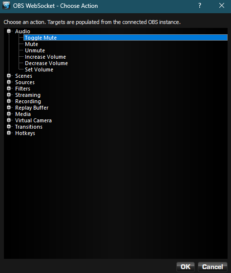
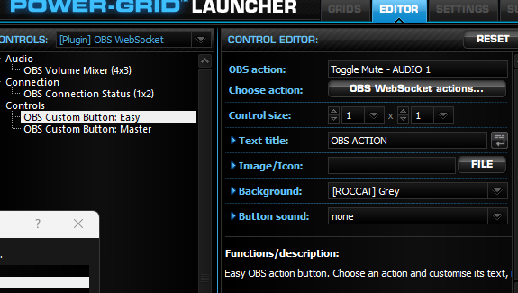
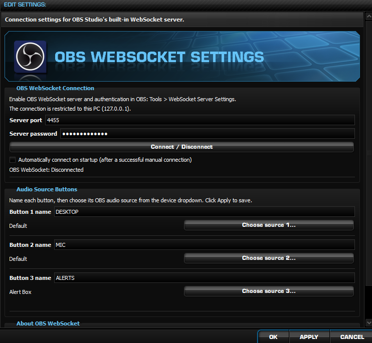

# OBS WebSocket v0.1.16 for ROCCAT Power-Grid

Control OBS Studio from the restored ROCCAT Power-Grid Launcher and its Android tablet controller. The plugin connects to OBS Studio's built-in **WebSocket 5.x server** on the Windows host.

**[Download OBSWebSocket_v0.1.16.rpgp](OBSWebSocket_v0.1.16.rpgp)**

## Custom OBS buttons

Two configurable controls appear under **[Plugin] OBS WebSocket → Controls**:

- **OBS Custom Button: Easy** — choose an OBS action and customise its text, icon/image, background, size and button sound.
- **OBS Custom Button: Master** — adds advanced button settings including touch triggers, active graphics, labels, gloss, positioning and styling.

Both use an **OBS WebSocket actions...** picker. Choose an action category, select the action and choose an OBS target where required. Scenes, sources and other available targets are populated from the connected OBS instance. Previously discovered targets remain available while OBS is offline, and names can also be entered manually.

### Available button actions

| Category | Actions |
| --- | --- |
| **Audio** | Toggle Mute, Mute, Unmute, Increase Volume, Decrease Volume, Set Volume — using any of the three configured audio slots |
| **Scenes** | Next Scene, Previous Scene, Switch Program Scene, Set Preview Scene, Trigger Studio Transition, Enable/Disable Studio Mode |
| **Sources** | Show, Hide or Toggle Scene Item Visibility |
| **Filters** | Enable, Disable or Toggle a Source Filter |
| **Streaming** | Start, Stop or Toggle Streaming |
| **Recording** | Start, Stop, Toggle, Pause, Resume or Toggle Recording Pause |
| **Replay Buffer** | Start, Stop, Toggle or Save Replay |
| **Media** | Play, Pause, Restart, Stop, Next or Previous Media Item |
| **Virtual Camera** | Start, Stop or Toggle Virtual Camera |
| **Transitions** | Select an OBS Transition |
| **Hotkeys** | Trigger a named OBS Hotkey |

There are **43 selectable actions**. The action is assigned to the button; its title, icon and appearance can be customised independently. OBS carries out its configured scene transitions when a button changes the active scene.

## Purple rotary volume mixer

The **OBS Volume Mixer (4x3)** provides three independent, nameable audio-source buttons. Select a source, turn the purple rotary to adjust its OBS volume, or press the centre **MUTE** button. Changes made in OBS also update the Power-Grid control. The original ROCCAT Windows volume controls are unchanged.

The plugin also includes **OBS Connection Status (1x2)**, showing the current WebSocket connection state and detected audio-input count.

## Requirements

- ROCCAT Power-Grid Launcher **0.461**, restored with [Power-Grid Rescue](https://github.com/fistmaster2k4/Power-Grid-Rescue).
- OBS Studio with its built-in **WebSocket 5.x server**, normally on port **4455**.
- Windows Power-Grid host connected to its Android Power-Grid controller.

The `.rpgp` installs on the Windows host, **not** on Android. The plugin connects to OBS on `127.0.0.1` only.

## Installation and setup

1. In OBS Studio, open **Tools → WebSocket Server Settings**. Enable the server and authentication, then note the port and password.
2. Double-click **[OBSWebSocket_v0.1.16.rpgp](OBSWebSocket_v0.1.16.rpgp)**. Import the plugin and restart the Power-Grid Launcher when prompted.
3. Approve the normal Power-Grid prompt allowing `OBSWebSocket.dll` to load.
4. Open **Settings → OBS WebSocket Settings** in the launcher. Enter the port and password, click **Apply**, then **Connect**.
5. Optionally enable **Automatically connect on startup** after a successful manual connection, then click **Apply**.
6. Under **Audio Source Buttons**, assign up to three OBS inputs and give their buttons your preferred names. Click **Apply**.
7. In the **Editor**, select **[Plugin] OBS WebSocket**. Add a volume mixer, connection tile or Easy/Master custom button to your grid.
8. For a custom button, click **OBS WebSocket actions...**, choose the action and target, then customise the button and add it to a grid.

### OBS WebSocket server settings

### Power-Grid OBS connection and audio-source settings

## Notes

- Audio-source selection can show Windows device-friendly names supplied by OBS. The same input may have a different name in OBS's mixer.
- Some actions require a corresponding OBS feature to be enabled or configured, such as Replay Buffer or Studio Mode.
- The WebSocket password field is masked in the launcher, but saved Power-Grid plugin settings should be treated as potentially readable. Use an appropriate OBS password.
- If a control reports **Plugin DLL missing**, ensure the imported DLL was approved and restart the launcher.

Built with PDK v0.3.31

## Attribution

Original ROCCAT volume-control artwork was used as a preservation reference and recoloured for the purple mixer. ROCCAT/Power-Grid and OBS Studio belong to their respective owners. This is an unofficial community restoration project, not an official OBS or ROCCAT release.
