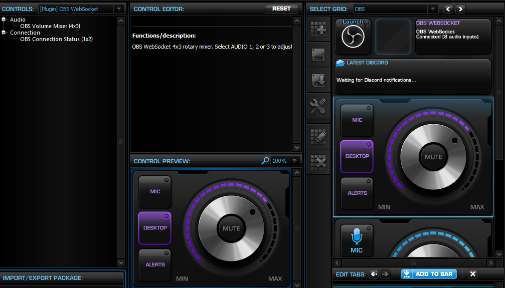
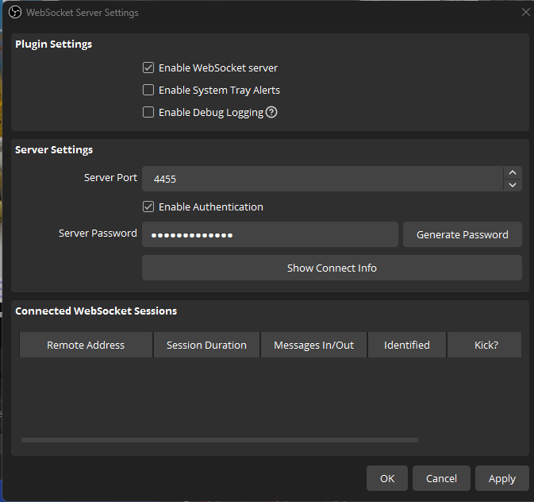
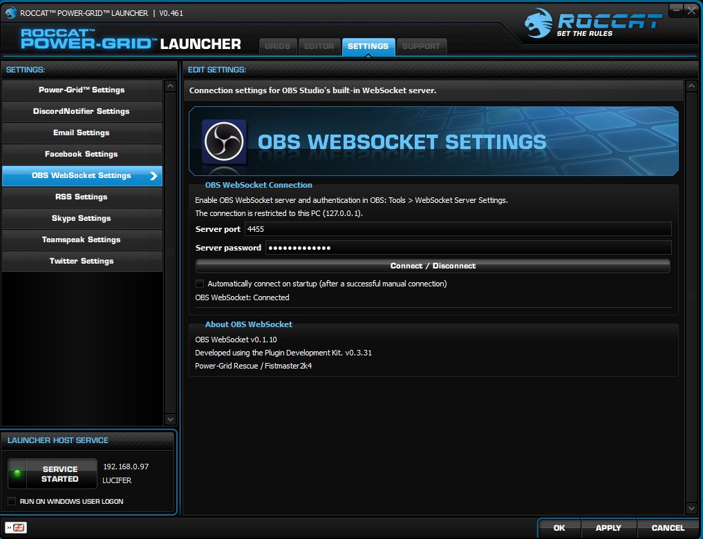
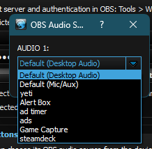
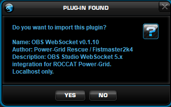
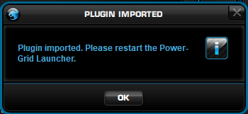
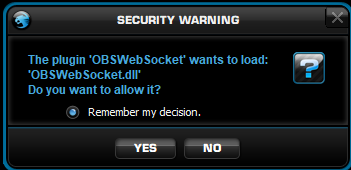

# OBS WebSocket v0.1.15 for ROCCAT Power-Grid

**Control OBS Studio's audio mixer from the restored ROCCAT Power-Grid launcher and an Android Power-Grid controller.**

This unofficial [Power-Grid Rescue](https://github.com/fistmaster2k4/Power-Grid-Rescue) plugin connects to OBS Studio's built-in **WebSocket 5.x server** and brings back the original 4×3 rotary volume-control experience, complete with a purple radial mask. The plugin runs locally on the Windows host; the Power-Grid Android client acts as its remote control.

**Current tested build: v0.1.15** The rotary, source selection and mute controls work in both directions. Changing a mixer slider directly in OBS updates Power-Grid automatically, with a small refresh delay.

**[Download the ready-to-install OBSWebSocket_v0.1.15.rpgp](OBSWebSocket_v0.1.15.rpgp)** · [Download the v0.1.15 source package](OBSWebSocket_v0.1.15_SOURCE.zip)

## The purple rotary mixer

The purple ring uses the **original Power-Grid radial-mask artwork and behaviour**, with a recoloured light effect. It follows the currently selected OBS source's volume; it is not a separate row of individually switched LEDs. The original blue Windows volume control remains untouched.

## Features

- **Three configurable audio-source buttons:** Select an OBS audio input for each button, then rename it to anything useful (for example **MIC**, **DESKTOP** and **ALERTS**).
- **Bidirectional volume control:** Turn the rotary to adjust the selected source inside OBS, or adjust that source in OBS and watch the rotary follow.
- **Mute/unmute:** Press the rotary's centre button to toggle the selected source's OBS mute state.
- **Persistent purple volume indication:** Smooth partial-fill radial mask from the original ROCCAT control, recoloured purple and kept in sync with the OBS value.
- **Connection status tile:** Optional 1×2 tile showing connection state and detected audio-input count.
- **Built-in OBS WebSocket 5.x support:** Password authentication, input discovery, disconnect/reconnect and optional automatic connection after a successful manual connection.
- **Localhost only:** The plugin's WebSocket client connects to OBS on the same Windows machine, not to a remote OBS instance.

This controls **OBS mixer levels**, which are independent of the corresponding Windows master/microphone volume settings. The plugin does not modify Power-Grid's stock Windows mixer.

## Requirements

- Working **ROCCAT Power-Grid 0.461**, restored with [Power-Grid Rescue](https://github.com/fistmaster2k4/Power-Grid-Rescue).
- **OBS Studio with its built-in WebSocket 5.x server** (normally listening on port `4455`).
- The included `.rpgp` package, installed on the Windows Power-Grid host.
- The OBS plugin does **not** install inside Android.

## Installation and setup

1. In OBS Studio, open **Tools → WebSocket Server Settings**, enable the server and authentication, and note the port and generated password, or create your own password.
2. Double-click **[OBSWebSocket_v0.1.15.rpgp](OBSWebSocket_v0.1.15.rpgp)**. Approve the Power-Grid plugin import and restart the Power-Grid Launcher when prompted.
3. On first use, approve the normal Power-Grid security prompt allowing `OBSWebSocket.dll` to load.
4. In **Power-Grid Launcher → Settings → OBS WebSocket Settings**, enter the port and password. Click **Apply**, then **Connect**.
5. Once connected, optionally enable **Automatically connect on startup** and click **Apply** again.
6. In **Audio Source Buttons**, choose three discovered audio sources from the dropdowns and enter your preferred button names. Apply the changes.
7. In the **Editor**, select **[Plugin] OBS WebSocket → Audio → OBS Volume Mixer (4x3)** and add it to a grid. The separate **Connection → OBS Connection Status (1x2)** control is also available.
8. Tap a source button, rotate the dial or press **MUTE**. Change the same source's volume in OBS to verify that the purple ring follows automatically.

The source names displayed in the selector can reflect Windows device-friendly names exposed by OBS. A source may have a different display name in OBS itself.

### OBS WebSocket server settings

### Power-Grid's OBS WebSocket settings

### Audio input selection

**Screenshot note:** The settings and source-dropdown images above were captured during early development (some show v0.1.10), before the three source selectors and renamable buttons were finalised. The downloadable package is **v0.1.15**.

## Power-Grid installation prompts

These are the normal Power-Grid plugin import and DLL approval screens; the captures also come from an earlier development build.

## Troubleshooting

| Symptom | Check |
| --- | --- |
| `Plugin DLL missing` on the grid | Ensure `OBSWebSocket.dll` was imported, Power-Grid was restarted, and the DLL was approved at the security prompt. The v0.1.15 package contains the DLL. |
| Not connected | Enable the WebSocket server in OBS, confirm port `4455` (or your custom port), enter the authentication password, click **Apply** and **Connect**. |
| Source buttons show an unexpected input | Reassign the three **Audio Source Buttons** in the plugin settings, then **Apply**. |
| Volume changes appear slightly delayed | The control refreshes the OBS volume roughly every **250 ms**, with some additional host/device rendering latency. |
| Purple mask does not persist | Verify that you are using **v0.1.15**, which restores the host's mask feed after it is reset. |

**Credential note:** The password field is masked on screen, but Power-Grid's settings persistence is not known to encrypt plugin passwords. Use an appropriate unique OBS password and avoid distributing your local Power-Grid configuration files.

## Source and implementation

The **[source archive](OBSWebSocket_v0.1.15_SOURCE.zip)** contains the C++ Qt 4 plugin source, `.qs` control scripts, manifests and recoloured mixer graphics. It does **not** contain a compiled DLL; use the [Power-Grid Plugin Development Kit](../../Development%20Tools/) to build for **Windows x86 / Qt 4.8.x**, or install the ready-made `.rpgp` above.

The OBS WebSocket functions are exposed through Power-Grid's incoming-data-source bridge, and the rotary's radial mask is fed with the selected source's current OBS volume through the original Power-Grid function-result mechanism. The `250 ms` refresh also restores the mask result if the host clears it. This is the mechanism tested in **v0.1.15**.

The original ROCCAT volume-control graphics were used as preservation references and recoloured for this plugin. ROCCAT/Power-Grid and OBS Studio remain the property of their respective owners. This is an unofficial community restoration project, not an official OBS or ROCCAT release.
