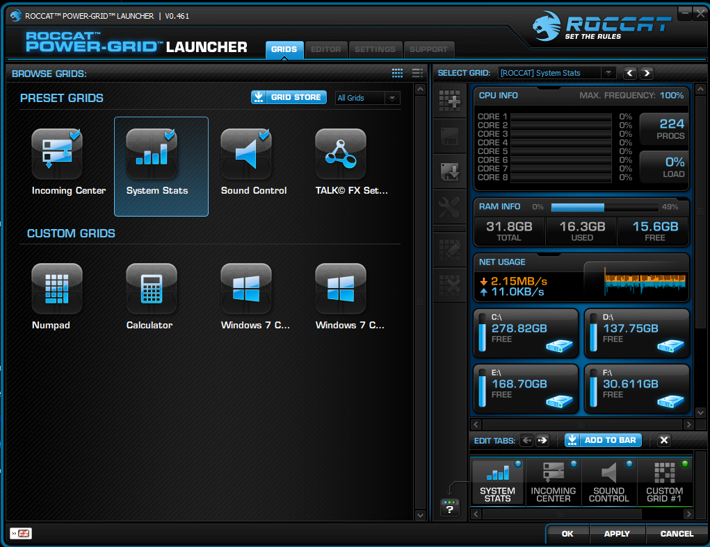
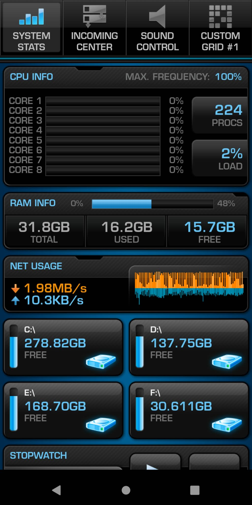

# Power-Grid-Rescue
Power-Grid Rescue is a preservation and restoration project for ROCCAT Power-Grid, the desktop/mobile control system that allowed Android devices to act as customizable macro panels, dashboards, and remote controls for a Windows PC.
Power-Grid was a genuinely useful piece of software, but much of its original functionality became unusable after the online services it depended on disappeared.
This project aims to make Power-Grid usable again while preserving the original workflow and behaviour as closely as possible.

## Original interfaces

### Windows application

### Android application

The goals are simple:
- restore offline/local operation
- preserve compatibility with existing Power-Grid grids
- restore communication between the Windows application and Android clients
- retain the original macro/control behaviour
- remove unnecessary dependence on dead web services
- preserve original installers, applications, grids, and related material where possible
- document how the system worked so it does not disappear completely
This is not intended to redesign Power-Grid into a different application. The aim is to rescue the software that already existed and make it functional again.

# Current status
The restored system is already capable of communicating between the Windows Power-Grid application and Android devices again.
Existing grids can be loaded and transferred to a connected device, and controls pressed on the mobile client are returned to the Windows application where the original macro/action system handles them.
The project is still being investigated and expanded, including work around the original grid library, user profiles, device compatibility, and long-term preservation.

## Android compatibility

The original ROCCAT Power-Grid Android client was released for **Android 2.2 (Froyo / API 8) and later**.

The current Power-Grid Rescue Android build has been tested successfully on **Android 11**. Older and newer Android versions may also work, but Android 11 is the currently confirmed modern test baseline for this project.

## Power-Grid Rescue Patcher v0.1.2

The **Power-Grid Rescue Patcher** updates the original Windows application (**ROCCAT Power-Grid build 0461**) without requiring a complete reinstallation.

The patcher retains the existing executable repairs:
- Expands the available grid slots from **2 to 12**.
- Bypasses obsolete account/activation checks that depended on discontinued services.
- Redirects the abandoned ROCCAT backend connection to localhost.

**New in v0.1.2 — Incoming Center fix**

- Dismissed notifications no longer reappear merely because you switch away from the Incoming Center grid and return.
- Notification-source display filters (such as hiding Email while continuing to show DiscordNotifier) are retained across grid changes and saved through Power-Grid's configuration system.
- The corrected `IncomingCenter.qs` resource is included in the patcher; there is no need to copy it manually.
- The patcher detects the executable patch and Incoming Center resource patch **independently**, so installations already running the previous Rescue EXE patch can apply the new resource fix.
- The original executable and original Incoming Center script are backed up independently for restoration.

The Incoming Center fix addresses **grid-switching state loss**. Notification sources can legitimately produce new entries on a new application session, and notifications that are regenerated by plugins should not be mistaken for previously dismissed entries being restored.

**Using the patcher:** Close Power-Grid, run the v0.1.2 patcher, select the Power-Grid installation if it is not detected automatically, and use **PATCH / UPDATE** when an update is available. When both components are already patched, the button is disabled; the status panel reports their installed state. The **RESTORE** control uses the saved originals.

Download the available build and source from [GitHub Releases](../../releases).

# Preservation approach
Where possible, original files are kept separate from restored or modified components.
The project may include:
- original installers
- restored/patched application files
- rebuilt or modified Android clients
- recovered .rpgp grid files
- documentation
- reverse-engineering notes
- compatibility fixes
  
The intention is to keep the original software experience recognizable while replacing only the parts that no longer function because of unavailable infrastructure.

# Project philosophy
Power-Grid was useful because it let almost any spare Android device become a flexible control surface without requiring expensive dedicated hardware.
This project exists because software like that deserves to remain usable even after its original services disappear.

## Download

Ready-to-use Windows and Android rescue builds are available from the
**[Releases](../../releases/latest)** page.

You do not need to compile anything to use Power-Grid Rescue.

# Legal Notice
*This repository is a preservation and restoration project 
for ROCCAT Power-Grid. Original ROCCAT/Turtle Beach software, assets, trademarks, and other third-party components remain the property of their respective rights holders. No ownership of those materials is claimed by this project.  
Any original restoration notes, documentation, or tooling created specifically for this project remain separately identifiable from third-party material.*
